
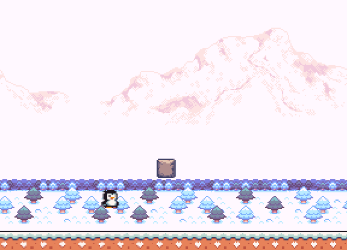
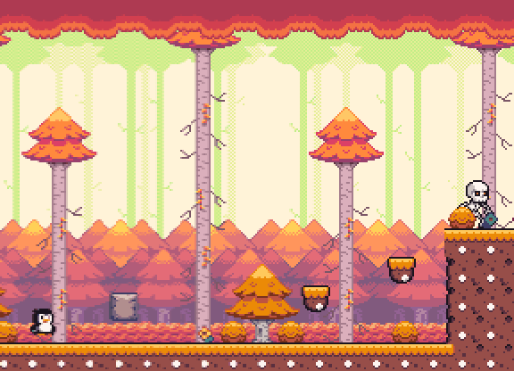
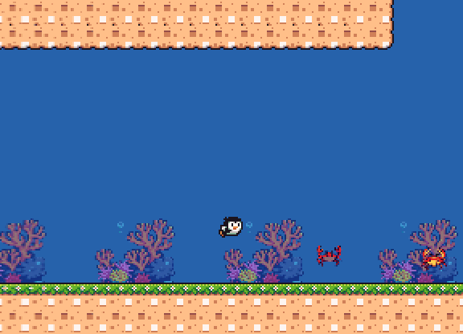

<div align="center">



# Peakguin

### Um platformer 2D em pixel art sobre explorar, superar obstáculos e conhecer um mundo em construção.

Projeto indie solo desenvolvido com Godot e GDScript — da programação e das mecânicas
ao level design, integração de assets e montagem das fases.

<p>
  
  
  
</p>

[**Baixar para Windows**](./downloads/Peakguin-v0.02-pre-alpha.exe) ·
[Ver o gameplay](#gameplay) ·
[Conhecer as mecânicas](#mecânicas) ·
[Executar o projeto](#como-executar)

<br>



<sub>Pradaria · Inverno · Floresta · Trópicos</sub>

</div>

## Sobre o jogo

**Peakguin** é meu primeiro jogo indie: um platformer 2D de aproximadamente três horas planejadas, dividido em regiões que introduzem novas mecânicas gradualmente.

O objetivo não é criar apenas uma sequência de plataformas. As fases também incluem exploração, inimigos, áreas submersas, objetos interativos e encontros com personagens. O projeto evolui enquanto estudo desenvolvimento de jogos e testo novas ideias de movimentação, combate e level design.

> [!NOTE]
> O jogo está em **Pre-Alpha**. Mecânicas, fases, arte e balanceamento ainda podem mudar significativamente.

## Gameplay

<table>
  <tr>
    <td width="50%" valign="top">
      
      <p align="center"><strong>Floresta, combate e plataformas</strong></p>
    </td>
    <td width="50%" valign="top">
      
      <p align="center"><strong>Exploração submersa</strong></p>
    </td>
  </tr>
</table>

## Mecânicas

<table>
  <tr>
    <td width="33%" valign="top">
      <strong>Movimentação</strong><br>
      Aceleração, múltiplos saltos, agachamento, deslize, paredes e natação.
    </td>
    <td width="33%" valign="top">
      <strong>Level design</strong><br>
      Plataformas móveis, blocos quebráveis, checkpoints, paralaxe, lava e projéteis.
    </td>
    <td width="33%" valign="top">
      <strong>Mundo</strong><br>
      Inimigos, criaturas, moedas, corações, NPCs e diálogos progressivos.
    </td>
  </tr>
  <tr>
    <td width="33%" valign="top">
      <strong>Estado do jogador</strong><br>
      Três corações, dano, cura, invulnerabilidade temporária, morte e respawn.
    </td>
    <td width="33%" valign="top">
      <strong>Interface</strong><br>
      HUD em pixel art, cronômetro persistente, menus, créditos e configurações.
    </td>
    <td width="33%" valign="top">
      <strong>Polimento</strong><br>
      Partículas, cursores próprios, efeitos de água e animações contextuais.
    </td>
  </tr>
</table>

A movimentação do personagem é organizada por uma máquina de estados. O sistema de diálogos possui áreas de interação, retratos, nomes e efeito de máquina de escrever. A sereia da região tropical é a primeira personagem integrada a esse fluxo.

## Regiões

| Região | Experiência planejada |
| --- | --- |
| **Pradaria** | Introdução à movimentação e aos primeiros obstáculos |
| **Inverno** | Plataformas em um cenário congelado e montanhoso |
| **Floresta** | Esqueletos, projéteis, lava e blocos interativos |
| **Trópicos** | Natação, caranguejos, exploração submersa e uma sereia |

## Controles

| Ação | Teclas |
| --- | --- |
| Mover | `A` / `D` ou setas laterais |
| Pular ou nadar | `W`, seta para cima ou `Espaço` |
| Agachar ou deslizar | `S` ou seta para baixo |
| Sentar ou levantar | `3` |

Os controles ainda podem mudar durante o desenvolvimento.

## Como executar

### Versão para Windows

Baixe [**Peakguin v0.02 Pre-Alpha**](./downloads/Peakguin-v0.02-pre-alpha.exe) e execute em Windows 64 bits. O arquivo ainda não possui assinatura digital, portanto o Windows pode solicitar confirmação.

### Projeto Godot

Requer **Godot 4.7.1**.

```bash
git clone https://github.com/rafaelcairess/Peakguin.git
cd Peakguin
```

Importe o arquivo `project.godot` no Godot e pressione `F5`. O projeto não requer dependências externas adicionais.

## Engenharia do projeto

| Área | Implementação |
| --- | --- |
| Gameplay | Cenas e scripts GDScript organizados por responsabilidade |
| Estado global | Autoloads para checkpoint, colecionáveis, diálogo, música, interface, save e configurações |
| Personagem | Máquina de estados para ações e transições de movimento |
| Level design | Cenas reutilizáveis para plataformas, perigos, projéteis, pickups e saídas |
| Apresentação | Viewport base de 288 × 208 com expansão para diferentes janelas |
| Conteúdo | 35 scripts GDScript e quatro regiões jogáveis em evolução |

<details>
<summary><strong>Ver estrutura principal do projeto</strong></summary>

```text
Peakguin/
├── entities/       # Jogador, inimigos, criaturas, NPCs e objetos
├── scene/          # Fases e regiões
├── scripts/        # Gameplay, estados e gerenciadores
├── tiles/          # Terrenos, água, lava e decoração
├── ui/             # HUD, menus e diálogos
├── audio/          # Música e efeitos sonoros
├── effects/        # Partículas e efeitos visuais
├── docs/           # GIFs e screenshots
└── project.godot
```

</details>

## Roadmap

- [x] Movimentação, natação e interação com paredes
- [x] Checkpoints, dano, cura e respawn
- [x] Inimigos, criaturas e objetos interativos
- [x] HUD, menus e sistema inicial de diálogos
- [ ] Expandir diálogos e adicionar novos NPCs
- [ ] Criar mais inimigos, regiões e áreas secretas
- [ ] Refinar animações, áudio e equilíbrio de dificuldade
- [ ] Construir uma progressão próxima de três horas

Não há previsão de conclusão. Como primeiro jogo e projeto solo, a prioridade é aprender e melhorar cada sistema de forma sustentável.

## Créditos e licença

Os assets de pixel art utilizados no projeto são de **GrafxKid**, disponibilizados sob a licença **CC0 1.0 Universal**. Consulte [`sprites/Seasonal Tilesets/LICENSE.txt`](./sprites/Seasonal%20Tilesets/LICENSE.txt).

Programação, integração, level design, mecânicas e desenvolvimento geral são realizados por **[Rafael Caires](https://github.com/rafaelcairess)**.

A licença do código-fonte ainda não foi definida. A licença CC0 dos assets citados não se estende automaticamente ao código do jogo.

<div align="center">

Se quiser acompanhar a evolução do Peakguin, deixe uma ⭐ no repositório.

</div>
